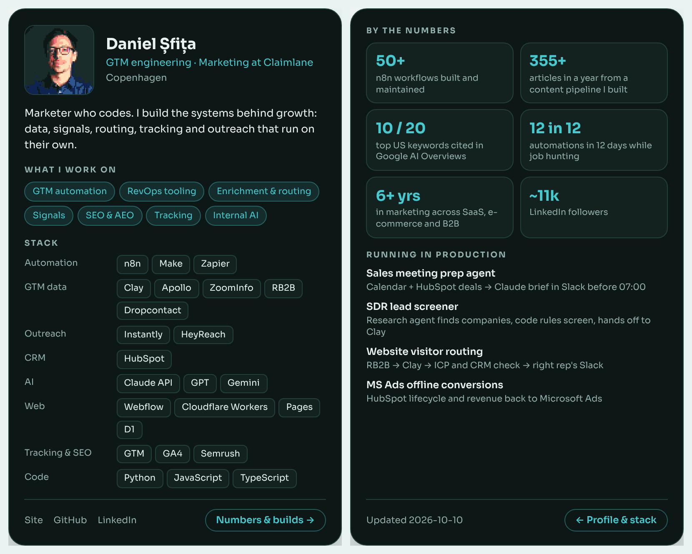

# GTM card

A one-page card with what you work on, the stack you actually use, and the numbers behind it. One JSON file, free hosting on GitHub Pages, about 10 minutes.



I made this for my own site because a "Skills: n8n, Clay, HubSpot" line on a CV says nothing. It doesn't say what you built or what's running every morning. **Live version: [babaliba-oss.github.io/gtm-card](https://babaliba-oss.github.io/gtm-card/)** · Daniel Șfița, [danielsfita.com](https://danielsfita.com)

## Make yours

1. **Copy the repo.** Click **Use this template** (or fork it).
2. **Make your pixel headshot.** Open `pixel.html` ([live version](https://babaliba-oss.github.io/gtm-card/pixel.html)), drop a photo, frame your face, download. Replace `avatar.png` with yours. The photo never leaves your browser.
3. **Fill in `card.json`.** Edit it by hand, or paste [PROMPT.md](PROMPT.md) into Claude or ChatGPT with your LinkedIn profile and let it do the first draft. Then check every number.
4. **Put it online.** Repo **Settings → Pages → Deploy from a branch → `main` / root → Save**. A minute later it's live at `https://<your-username>.github.io/<repo-name>/`.
5. **Share it.** Post it and drop the link under [my LinkedIn post](https://www.linkedin.com/in/daniel-%C8%99fi%C8%9Ba-ab7905119). I'll look at every one.

## What goes in card.json

| Field | What it is |
|---|---|
| `name`, `role`, `location` | Top of the card |
| `avatar` | Path to your image, `avatar.png` by default |
| `line` | One sentence on what you do |
| `focus` | 4 to 8 areas you work on |
| `stack` | Up to 8 groups: `{ "label": "Automation", "items": ["n8n", "Make"] }` |
| `nums` | Exactly 6: `{ "b": "50+", "t": "n8n workflows built and maintained" }` |
| `builds` | Up to 4 things running in production: `{ "name": "...", "what": "..." }` |
| `links` | Footer links: `{ "label": "GitHub", "url": "https://..." }` |
| `accent` | Highlight colour, any CSS colour |
| `updated` | Date shown on the back |

Only tools you could open right now and show something you built. Only numbers you can back up and are allowed to share.

## Keep it true: the brain

A card goes stale like a CV does. The `brain/` folder is a small set of markdown pages about your own work: [me](brain/me.md), [stack](brain/stack.md), [proof](brain/proof.md), [voice](brain/voice.md) and a weekly [log](brain/log.md). The card is built from these.

I run a bigger version of this for myself. Every Monday a job reads my week, updates my notes and suggests changes. This starter is the part you need for the card.

**Update by hand:** paste [PROMPT.md](PROMPT.md) and your brain pages into any AI chat, copy the JSON back into `card.json`.

**Update every Monday automatically (optional):**
1. Add your Anthropic API key under **Settings → Secrets and variables → Actions → New repository secret**, named `ANTHROPIC_API_KEY`.
2. Turn on **Settings → Actions → General → Allow GitHub Actions to create and approve pull requests**.
3. That's it. Every Monday the [workflow](.github/workflows/update-card.yml) reads `brain/`, updates `card.json` and opens a pull request. Nothing changes until you merge it. You can also run it by hand from the **Actions** tab. A run costs a fraction of a cent.

The script refuses anything that doesn't match the card's shape, and it's told to never invent facts. Still read the pull request before merging.

## Put it on your own site

```html
<iframe src="https://<your-username>.github.io/<repo-name>/" style="width:100%;max-width:440px;height:820px;border:0" title="GTM card"></iframe>
```

## Run it locally

`card.json` is loaded with `fetch`, so opening `index.html` straight from disk won't work. Run `python3 -m http.server` in the folder and open `http://localhost:8000`.

## Files

```
index.html          the card
card.json           your content
avatar.png          your pixel headshot
pixel.html          the headshot maker
brain/              notes the card is built from
PROMPT.md           prompt to fill in the card with AI
scripts/            weekly update script
.github/workflows/  weekly update job
```

MIT licensed. Use it, change it, no credit needed. A link back is nice though.
